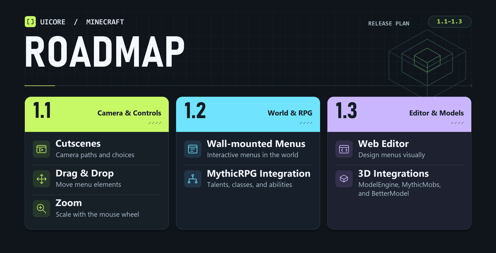

# UIcore

> **Language:** English | [Русская версия](README_RU.md)

> **Note:** This project includes AI-generated code written with Codex.

> **Support:** [Discord](https://discord.gg/cBq76BmfKu)

### A world-space UI framework for Minecraft servers

UIcore turns the game world into a stage for menus. Text, items, buttons, input fields, stateful elements, animated slots, NPC mirrors, and per-player previews live in the same scene as the player instead of inside a flat inventory window.

UIcore 1.1.0 adds camera cutscenes, drag and drop, and mouse-wheel zoom. [Download the release](https://github.com/kekaop/UIcore/releases/tag/v1.1.0) · [Release notes](release/RELEASE_NOTES.md).

The project exists thanks to **wuhaoxian123** (Discord: @wuhaoxian123), the original CustomScreenMenu author. UIcore is based on the paid 1.4.8 build, with permission to publish the complete source under AGPL-3.0. See the [original plugin page](https://builtbybit.com/resources/customscreenmenu.108929/) and [LICENSE](LICENSE).

## What is included

- Per-menu privacy for displays and players, with optional protection from player damage.
- World-space menus rendered around the player camera.
- Per-player camera cutscenes with routes, velocity curves, pauses, and branching choices.
- Parent groups, drag and drop, sliders, and optional mouse-wheel zoom.
- Text, item, button, input, state, slot, and schematic-preview systems.
- A public API for menus, elements, input fields, slots, state, actions, data providers, conditions, and components.
- Optional integrations built into the UIcore JAR: Vault and LuckPerms.
- Paper and Folia-aware scheduling with Java 17 bytecode.
- Russian and English guides, including a full menu authoring reference.

## Roadmap



## Build UIcore

Build with JDK 21 or newer and Maven 3.9 or newer. The output uses Java 17 bytecode; the SkinsRestorer compile dependency requires a newer JDK.

Run:

```bash
mvn clean package
```

The build produces:

- `uicore-api/target/uicore-api-1.1.0.jar`
- `uicore-plugin/target/UIcore-1.1.0.jar`
- `uicore-example-extension/target/uicore-example-extension-1.1.0.jar`

## Add the API to a plugin

```xml
<dependency>
  <groupId>io.github.kekaop</groupId>
  <artifactId>uicore-api</artifactId>
  <version>1.0.0</version>
  <scope>provided</scope>
</dependency>
```

Maven Central hosts `io.github.kekaop:uicore-api:1.0.0`. For the new 1.1.0 API, run
`mvn -pl uicore-api -am install` from the 1.1.0 source checkout and use version
`1.1.0` in your dependency. Install UIcore on the server and use `provided` in
extension builds. See the [API guide](https://github.com/kekaop/UIcore/wiki/Java-API).
Declare the Paper API dependency and Paper repository in your plugin build when
compiling against UIcore's Paper types.

## Runtime requirements

- Minecraft 1.21.1 and newer on Paper, Folia, Purpur, or a compatible fork.
- Java 17 bytecode. Use the Java runtime required by the selected server build.
- [PacketEvents 2.14.0 Spigot](https://modrinth.com/plugin/packetevents/version/m78nFxYg) is required.
- PlaceholderAPI, FancyNpcs, SkinsRestorer, CraftEngine, Vault, and LuckPerms are optional.

**Client compatibility:** NoChatReports may cause chat input to fail, including after a menu closes. See the [symptoms, cause, and workaround](https://github.com/kekaop/UIcore/wiki/Compatibility#nochatreports-can-break-chat-input).

## Documentation

English is the primary documentation language. Each translated page links to its Russian counterpart.

- [GitHub Wiki](https://github.com/kekaop/UIcore/wiki) · [Русская главная страница](https://github.com/kekaop/UIcore/wiki/Home-RU)
- [Documentation index](https://github.com/kekaop/UIcore/wiki/Home)
- [Menu authoring guide](https://github.com/kekaop/UIcore/wiki/Menu-Guide) · [Русская версия](https://github.com/kekaop/UIcore/wiki/Menu-Guide-RU)
- [Camera cutscenes](https://github.com/kekaop/UIcore/wiki/Cutscenes) · [Русская версия](https://github.com/kekaop/UIcore/wiki/Cutscenes-RU)
- [Groups, drag and drop, and zoom](https://github.com/kekaop/UIcore/wiki/Interactions) · [Русская версия](https://github.com/kekaop/UIcore/wiki/Interactions-RU)
- [Extension API](https://github.com/kekaop/UIcore/wiki/Extension-API) · [Русская версия](https://github.com/kekaop/UIcore/wiki/Extension-API-RU)
- [Built-in integrations](https://github.com/kekaop/UIcore/wiki/Integrations) · [Русская версия](https://github.com/kekaop/UIcore/wiki/Integrations-RU)
- [Compatibility matrix](https://github.com/kekaop/UIcore/wiki/Compatibility) · [Русская версия](https://github.com/kekaop/UIcore/wiki/Compatibility-RU)
- [Installation guide](https://github.com/kekaop/UIcore/wiki/Installation) · [Русская версия](https://github.com/kekaop/UIcore/wiki/Installation-RU)
- [Runtime contracts](https://github.com/kekaop/UIcore/wiki/Runtime-Contracts)

## Try the demo menus

Open `/uicore run demo_main` to explore the three introductory examples. They use vanilla Minecraft items and work without a resource pack or optional plugins.

| Menu                                                                   | Features                                                                       |
| ---------------------------------------------------------------------- | ------------------------------------------------------------------------------ |
| [demo_main](uicore-plugin/src/main/resources/menu/demo_main.yml)       | Hover effects, cursor changes, chat input, toggles, and click cooldowns        |
| [demo_gallery](uicore-plugin/src/main/resources/menu/demo_gallery.yml) | Item displays, your avatar, and a template slot with three selectable previews |
| [demo_states](uicore-plugin/src/main/resources/menu/demo_states.yml)   | Text, material, visibility, permission styles, and click requirements          |
| [demo_cutscene](uicore-plugin/src/main/resources/menu/demo_cutscene.yml) | Camera motion and branching choices                                           |
| [demo_drag](uicore-plugin/src/main/resources/menu/demo_drag.yml)       | Parent groups, a slider, a receiving slot, and experimental hold-to-drag      |
| [demo_zoom](uicore-plugin/src/main/resources/menu/demo_zoom.yml)       | Mouse-wheel zoom, click-to-pick-up dragging, and actions after a drop         |

The gallery selectors require `uicore.slot` (granted to OP players by default). See the [demo walkthrough](https://github.com/kekaop/UIcore/wiki/Lab) · [Русская версия](https://github.com/kekaop/UIcore/wiki/Lab-RU).

## Showcase videos

### Custom server menu

An example of a server interface built with UIcore: a player profile, world selection, friends, and settings, connected through menu navigation.

https://github.com/user-attachments/assets/50bd8035-eb6a-4ecd-9941-b3f17b2cd196

### Bundled demo menus

A walkthrough of `demo_main`, `demo_states`, and `demo_gallery`: hover feedback, chat input, toggles, element states, item displays, avatars, and template selection.

https://github.com/user-attachments/assets/60c09f38-9699-4fa7-9ec8-5ccf51af7e2b
