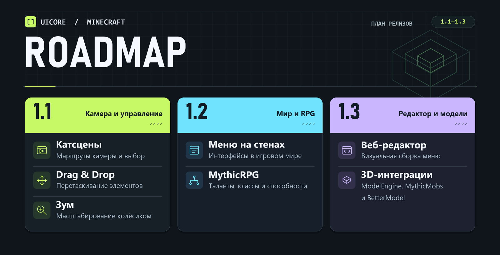

# UIcore

> **Язык:** [English](README.md) | Русский

### UI-фреймворк для Minecraft, работающий прямо в мире

UIcore строит меню вокруг камеры игрока. Текст, предметы, кнопки, поля ввода, состояния, слоты, NPC-зеркала и персональные предпросмотры схем находятся в одной сцене с игроком.

Основной язык репозитория и документации — английский. Эта страница помогает русскоязычным администраторам начать работу и ведёт к русским переводам справочника.

В UIcore 1.1.0 появились катсцены, перетаскивание и зум колёсиком. [Скачать релиз](https://github.com/kekaop/UIcore/releases/tag/v1.1.0) · [Список изменений](release/RELEASE_NOTES_RU.md).

## Что входит

- Настройки видимости меню и игроков, а также защиты от урона игроков для каждого меню.
- Мировые меню, элементы текста и предметов, кнопки, поля ввода, состояния и анимации.
- Слоты и персональные предпросмотры Sponge `.schem`.
- Java API для действий, источников данных, условий, компонентов, меню и слотов.
- Встроенная поддержка Vault и LuckPerms.
- Планировщики Paper и Folia, bytecode Java 17.
- Катсцены с маршрутами камеры, кривыми скорости, паузами и ветками выбора для каждого игрока.
- Родительские группы, перетаскивание, ползунки и зум колёсиком.

## План развития



## Сборка

Для сборки нужны JDK 21 или новее и Maven 3.9 или новее. Результат использует bytecode Java 17; зависимость SkinsRestorer для компиляции требует более новый JDK.

```bash
mvn clean package
```

Плагин собирается в `uicore-plugin/target/UIcore-1.1.0.jar`. JAR для разработки расширений находится в `uicore-api/target/`, а готовый пример расширения — в `uicore-example-extension/target/`.

## Подключение API к другому плагину

```xml
<dependency>
  <groupId>io.github.kekaop</groupId>
  <artifactId>uicore-api</artifactId>
  <version>1.0.0</version>
  <scope>provided</scope>
</dependency>
```

В Maven Central доступен `io.github.kekaop:uicore-api:1.0.0`. Для нового API
выполните `mvn -pl uicore-api -am install` из исходников 1.1.0 и укажите версию
`1.1.0` в зависимости расширения. Установите UIcore на сервер и задайте
`provided` при сборке расширения. [Справочник API](https://github.com/kekaop/UIcore/wiki/Java-API-RU).
При компиляции расширения объявите отдельно зависимость `paper-api` и репозиторий
Paper, если используете типы Paper из UIcore API.

## Требования

- Minecraft 1.21.1 и новее на Paper, Folia, Purpur или совместимом форке.
- Java, требуемая выбранной сборкой сервера. Сам плагин собран с bytecode Java 17.
- [PacketEvents 2.14.0 Spigot](https://modrinth.com/plugin/packetevents/version/m78nFxYg) обязателен.

PlaceholderAPI, FancyNpcs, SkinsRestorer, CraftEngine, Vault и LuckPerms подключаются по необходимости.

**Совместимость клиента:** NoChatReports может нарушать ввод через чат, в том числе после закрытия меню. [Симптомы, причина и обходное решение](https://github.com/kekaop/UIcore/wiki/Compatibility-RU#проблемы-чата-с-nochatreports).

## Демонстрационные меню

Начните с `/uicore run demo_main`. Плагин устанавливает недостающие примеры при запуске.

- [demo_main](uicore-plugin/src/main/resources/menu/demo_main.yml) — наведение, смена курсора, ввод через чат, переключатель и задержка между кликами.
- [demo_gallery](uicore-plugin/src/main/resources/menu/demo_gallery.yml) — предметы, аватар игрока и смена шаблонов в слоте.
- [demo_states](uicore-plugin/src/main/resources/menu/demo_states.yml) — изменение текста, материала и видимости, оформление по правам и ограничения кликов.

Ресурс-пак и дополнительные плагины не нужны. Для кнопок выбора в галерее требуется `uicore.slot`; OP получает это право по умолчанию. [Инструкция и сценарий демонстрации](https://github.com/kekaop/UIcore/wiki/Lab-RU) · [English](https://github.com/kekaop/UIcore/wiki/Lab).

В 1.1.0 также входят `demo_cutscene` с ветками выбора, `demo_drag` с экспериментальным удержанием ЛКМ и `demo_zoom` с масштабированием колёсиком. [Настройки взаимодействия](https://github.com/kekaop/UIcore/wiki/Interactions-RU).

## Видео

### Пример меню сервера

Интерфейс сервера на UIcore: профиль игрока, выбор миров, друзья и настройки с переходами между меню.

https://github.com/user-attachments/assets/50bd8035-eb6a-4ecd-9941-b3f17b2cd196

### Демонстрационные меню плагина

Обзор `demo_main`, `demo_states` и `demo_gallery`: эффекты наведения, ввод через чат, переключатели, состояния элементов, предметы, аватары и выбор шаблонов.

https://github.com/user-attachments/assets/60c09f38-9699-4fa7-9ec8-5ccf51af7e2b

[Сценарий для записи новых роликов](https://github.com/kekaop/UIcore/wiki/Lab-RU). Видео находятся вне JAR плагина.

## Документация

- [GitHub Wiki](https://github.com/kekaop/UIcore/wiki) · [Главная страница на русском](https://github.com/kekaop/UIcore/wiki/Home-RU)
- [Английский индекс документации](https://github.com/kekaop/UIcore/wiki/Home-RU)
- [Справочник автора меню](https://github.com/kekaop/UIcore/wiki/Menu-Guide-RU) · [English](https://github.com/kekaop/UIcore/wiki/Menu-Guide)
- [Система катсцен](https://github.com/kekaop/UIcore/wiki/Cutscenes-RU) · [English](https://github.com/kekaop/UIcore/wiki/Cutscenes)
- [Группы, перетаскивание и зум](https://github.com/kekaop/UIcore/wiki/Interactions-RU) · [English](https://github.com/kekaop/UIcore/wiki/Interactions)
- [API расширений](https://github.com/kekaop/UIcore/wiki/Extension-API-RU) · [English](https://github.com/kekaop/UIcore/wiki/Extension-API)
- [Vault и LuckPerms](https://github.com/kekaop/UIcore/wiki/Integrations-RU) · [English](https://github.com/kekaop/UIcore/wiki/Integrations)
- [Совместимость](https://github.com/kekaop/UIcore/wiki/Compatibility-RU) · [English](https://github.com/kekaop/UIcore/wiki/Compatibility)
- [Установка](https://github.com/kekaop/UIcore/wiki/Installation-RU) · [English](https://github.com/kekaop/UIcore/wiki/Installation)

UIcore основан на CustomScreenMenu 1.4.8 и публикуется с разрешения автора исходного плагина, **wuhaoxian123**. Подробнее: [страница CustomScreenMenu](https://builtbybit.com/resources/customscreenmenu.108929/) и [LICENSE](LICENSE).
